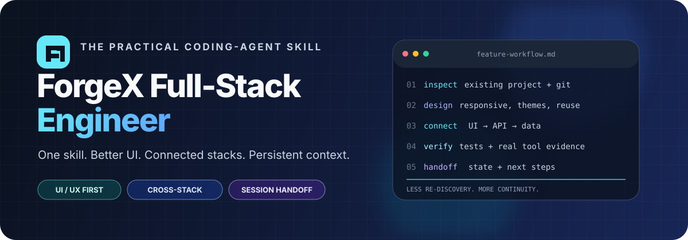
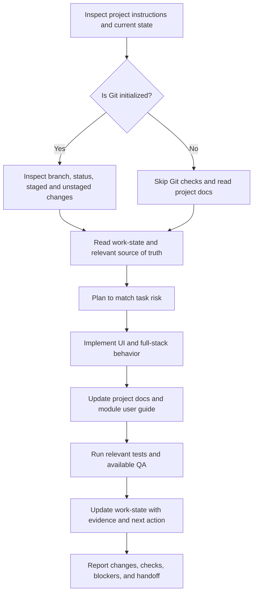

<div align="center">
  

  <h1>ForgeX Full-Stack Engineer</h1>
  <p><strong>One practical skill for coding agents that build across the full stack—and remember where the work left off.</strong></p>
  <p>
    <a href="https://opensource.org/licenses/MIT"></a>
    
    
    <a href="https://skills.sh/DanDhany/forgex-fullstack-engineer"></a>
    
  </p>
  <p>
    <a href="#-quick-start">Quick start</a> ·
    <a href="#-what-makes-it-different">Why ForgeX</a> ·
    <a href="#-agent-compatibility">Supported agents</a> ·
    <a href="#-the-workflow">Workflow</a> ·
    <a href="#-contributing">Contribute</a>
  </p>
</div>

---

**ForgeX Full-Stack Engineer** is an all-in-one skill for AI coding agents. It gives agents a practical workflow for building polished interfaces, keeping frontend and backend contracts aligned, documenting new modules, checking uncommitted work safely, and handing context to the next session or agent.

It is designed for developers who move between prototypes and real applications—and are tired of repeating the same instructions every time a context window runs out.

> **The goal:** less re-discovery, fewer disconnected layers, more deliberate UI, and a clear next step when you switch agents.

## One skill, modular expertise

ForgeX installs as a single skill entry point (`skills/forgex/SKILL.md`). Its focused reference modules are loaded conditionally; users do not need to install or orchestrate each internal module. See [`docs/ARCHITECTURE.md`](docs/ARCHITECTURE.md), [`skills/forgex/references/module-routing.md`](skills/forgex/references/module-routing.md), and [`docs/UPSTREAM-REFERENCES.md`](docs/UPSTREAM-REFERENCES.md) for routing, workflows, external-source boundaries, and licensing policy.

ForgeX aims to make one- or two-shot implementation more reliable through repository discovery, proportional planning, focused expertise, real verification, correction loops, and honest handoff. It cannot guarantee production readiness independent of model capability, permissions, available tools, and project state.

## ✨ What makes it different?

<table>
  <tr>
    <td width="50%" valign="top">
      <h3>🎨 UI/UX is part of engineering</h3>
      Start with the product and existing design system. ForgeX infers routine design choices from a short request, chooses a product-specific art direction before substantial UI work, and closes the loop with rendered critique and refinement when browser tools are available. Typography, tonal palette hierarchy, mobile overflow, responsive layouts, light and dark themes, reusable components, accessibility, and interaction states are explicit acceptance criteria—not last-minute polish.
    </td>
    <td width="50%" valign="top">
      <h3>🔗 Full-stack changes stay connected</h3>
      Trace a feature from the UI event through client state, API route, validation, business logic, database, response contract, and final UI state. Catch mismatched types, stale mocks, hardcoded production data, and errors that never reach the user.
    </td>
  </tr>
  <tr>
    <td width="50%" valign="top">
      <h3>🧠 Handoff instead of amnesia</h3>
      Maintain one project work-state or existing handoff file with current progress, changed files, decisions, test results, blockers, and the next action. A replacement agent can resume from a verified checkpoint instead of blindly rediscovering the repository.
    </td>
    <td width="50%" valign="top">
      <h3>📚 Docs evolve with the product</h3>
      Keep project source-of-truth documents aligned with implementation. Every new user-facing module gets practical usage instructions. Update existing docs where possible instead of generating a pile of nearly duplicate Markdown files.
    </td>
  </tr>
  <tr>
    <td width="50%" valign="top">
      <h3>🌗 Responsive and theme-aware</h3>
      Check mobile, tablet, and desktop layouts; light and dark themes; loading, empty, error, disabled, focus, hover, and active states. Browser checks are reported only when the required tooling was actually available and used.
    </td>
    <td width="50%" valign="top">
      <h3>🛡️ Risk-aware, not process-heavy</h3>
      Small edits get a lightweight workflow. Cross-stack, security-sensitive, payment, and data-integrity changes receive deeper planning, tests, and verification. Avoid unnecessary rewrites, dependencies, and ceremony.
    </td>
  </tr>
</table>

## 🧰 Supported stacks

ForgeX is designed for cross-stack work, not one framework only.

| Language / ecosystem | Typical work |
|---|---|
| **PHP + Laravel** | Web applications, API endpoints, validation, authorization, database workflows, Laravel-specific practices when relevant tools are available |
| **TypeScript + React** | Responsive interfaces, reusable UI, client state, typed API integration, frontend behavior |
| **Python + FastAPI** | API routes, request/response schemas, validation, service logic, backend integration |
| **JavaScript** | Frontend code, Node.js tooling, and JavaScript-based backend work |

ForgeX asks the agent to inspect the repository and installed versions before selecting APIs, commands, or patterns. Stack support does **not** imply every optional framework tool is installed.

## 🚀 Quick start

### Recommended: install with the Skills CLI

ForgeX contains one installable skill: `forgex`. Install it directly from the public GitHub repository, or run the bundled installer after cloning/downloading the repository.

**Install directly from GitHub:**

Project-local:

```bash
npx skills add DanDhany/forgex-fullstack-engineer --skill forgex
```

Global:

```bash
npx skills add DanDhany/forgex-fullstack-engineer --skill forgex -g
```

**Choose a specific coding agent** (example: Codex):

```bash
npx skills add DanDhany/forgex-fullstack-engineer --skill forgex --agent codex -g
```

**List available skills without installing:**

```bash
npx skills add DanDhany/forgex-fullstack-engineer --list
```

**Invoke the skill explicitly:**

- In **Codex CLI/IDE**, type `$forgex` in the prompt to invoke this skill explicitly. Use `/skills` to list available skills. Codex does **not** invoke skills with `/forgex`.
- In **Claude Code**, `/forgex` may be available as a skill command when the installed version exposes skills that way.
- In **other agents**, use the skill picker or the invocation syntax documented by that host. There is no universal slash-command syntax across all agents.
- ForgeX configures Codex for explicit invocation, so it will not be selected implicitly; this helps when you have many installed skills.

> **Important:** The bundled installer always fetches the current skill from the public GitHub repository. It does not use the skill copy in the local checkout as its install source. The Skills CLI also installs directly from GitHub and does not require ForgeX to be published as a separate npm package.

The current Skills CLI release may require a newer Node.js version than the bundled installer. Check the CLI documentation if it reports a runtime error. The bundled ForgeX installer requires Node.js 20 or newer.

### Alternative: use the bundled ForgeX installer

If you cloned or downloaded this repository and want ForgeX's own terminal UI, use Node.js 20 or newer:

```bash
node ./bin/install.js
```

The terminal UI downloads the canonical skill files from the public `DanDhany/forgex-fullstack-engineer` GitHub repository at install time, then guides you through agent selection, installation scope, destination preview, and confirmation. It does not install from the local checkout, does not require `npm install`, and requires an internet connection.

### Verify or troubleshoot

```bash
npx skills --help
npx skills list
npx skills check
node ./bin/install.js --help
node ./bin/install.js --list-agents
node ./bin/install.js --dry-run
npm test
```

The Skills CLI has its own Node.js requirements; check its current documentation if `npx skills` reports a version error. The bundled ForgeX installer requires Node.js 20 or newer.

## 🤖 Agent compatibility

The installer currently includes default paths for these agents. Directory conventions and skill discovery can change between agent versions, so check the agent's current documentation if a skill does not appear.

| Agent | Project-local directory | Global directory |
|---|---|---|
| OpenAI Codex | `.agents/skills/` | `~/.agents/skills/` |
| OpenCode | `.agents/skills/` | `~/.agents/skills/` |
| Claude Code | `.claude/skills/` | `~/.claude/skills/` |
| Cursor | `.agents/skills/` | `~/.cursor/skills/` |
| GitHub Copilot | `.github/skills/` | `~/.copilot/skills/` |
| Gemini CLI | `.agents/skills/` | `~/.gemini/skills/` |
| Windsurf | `.windsurf/skills/` | `~/.codeium/windsurf/skills/` |
| Antigravity | `.agents/skills/` | `~/.gemini/config/skills/` |

> The installer downloads the ForgeX skill and its references from GitHub. It does not automatically install browser automation, MCP servers, or other external tools.

## 🔄 The workflow



### The project memory pattern

For tracked prototypes, ForgeX encourages a compact set of project documents. Use the existing equivalents if the repository already has them; do not duplicate documents just to match filenames.

| Document | What it should answer |
|---|---|
| `product.md` | What are we building, for whom, and why? What is in scope? |
| `system.md` | How do the main components and integrations work together? |
| `design.md` | What are the UI principles, visual direction, themes, responsive rules, and reusable components? |
| `stack.md` | Which languages, frameworks, versions, dependencies, and commands are in use? |
| `database.md` | What are the entities, relationships, constraints, and migrations? |
| `agent.md` | How should coding agents work in this repository? |
| `WORK-STATE.md` | What is in progress, what changed, what was verified, what is blocked, and what should happen next? |

These are a useful default for a new prototype, not a requirement to create seven files in every repository. For an existing project, map to its established documentation and keep one clear handoff location.

## 🧪 Verification and honest limits

ForgeX provides workflow guidance; it cannot magically provide tools or guarantee a perfect result.

- **Tests and builds** depend on the project's dependencies and environment.
- **Visual/browser QA** requires an available browser-control tool or configured Playwright setup.
- **Current framework documentation** requires web access or a configured documentation integration when an appropriate documentation lookup integration is configured.
- **Laravel-specific workflows** can use compatible project-specific development tools if they are installed.
- **External UI audits or scanners** require their respective tools to be installed and available.

The agent must not claim that screenshots were captured, tests passed, or tools ran unless that actually happened. When a check is blocked, report it and explain the limitation.

## 🧩 Design and writing principles

ForgeX maintains its own engineering and design workflow. It emphasizes:

- Product-specific visual direction instead of generic, repeated UI patterns.
- Clear hierarchy, responsive layouts, light and dark themes, accessible interactions, and reusable components.
- Purposeful motion and interaction feedback rather than decoration for its own sake.
- Direct, natural, accurate copy that preserves technical detail and avoids filler.
- Evidence-based review: fix meaningful defects and report checks honestly.

The repository contains ForgeX-authored instructions and installer code. Optional documentation lookup, framework-specific tooling, and external scanners are separate tools; they are used only when installed, available, and relevant. ForgeX does not bundle those integrations.

## 📂 Repository layout

```text
.
├── assets/forgex-hero.svg
├── skills/forgex/
│   ├── SKILL.md
│   └── references/
├── bin/install.js
├── src/
├── test/
├── docs/
├── .github/workflows/ci.yml
├── README.md
├── CONTRIBUTING.md
├── SECURITY.md
├── CHANGELOG.md
└── LICENSE
```

## 🤝 Contributing

Issues, workflow improvements, bug reports, and well-scoped pull requests are welcome. Before contributing, read [`CONTRIBUTING.md`](CONTRIBUTING.md). Please keep the skill focused: add a rule when it solves a recurring failure mode, not just because another checklist could exist.

If ForgeX helps your workflow, consider giving the repository a ⭐ on GitHub, sharing it with another developer, or opening an issue with a reproducible example of where the skill helped—or fell short.

## 🔐 Security

Do not paste secrets into issues or examples. For security-sensitive reports, follow [`SECURITY.md`](SECURITY.md).

## 📄 License

ForgeX's original material is licensed under the [MIT License](LICENSE). External projects retain their own licenses and terms.

---

<div align="center">
  <strong>Build deliberately. Keep the stack connected. Leave a useful handoff.</strong>
  <br />
  <sub>ForgeX Full-Stack Engineer — an AI coding-agent skill for full-stack development, UI/UX quality, project documentation, and token-efficient session continuity.</sub>
</div>
